# Viewing an mdCIF file in ChimeraX: a step-by-step tutorial

An mdCIF file captures a simulation's main states as model structures, plus the three largest
**modes** of each state. A mode shows how the atoms move together. This tutorial looks at such
a file in [UCSF ChimeraX](https://www.cgl.ucsf.edu/chimerax/) with the mdcif plugin for
ChimeraX (the ChimeraX-MDCIF bundle in [`viewers/chimerax`](../../../viewers/chimerax)). The
plugin adds a few `mdcif` commands:

| Command | What it does |
|---|---|
| `mdcif porcupine` | arrows showing how each Cα moves in one mode |
| `mdcif animate` | a copy of a model that swings back and forth along one mode |
| `mdcif morph` | a movie that morphs from one model to the next |
| `mdcif modes` | lists the models and their modes in the Log |
| `mdcif open` | another way to open the file (the same as File → Open) |

We use the GB1 example, `examples/create/1_basic/gb1_meld_300K.cif`, made by
[`1_basic.ipynb`](../../create/1_basic/1_basic.ipynb): a 300 K MELD simulation of the protein G
B1 domain, summarised as two states.

**How to follow along.** Open ChimeraX and type each block of commands at its command line (the
box at the bottom of the window), in order: each block continues from the one before. Where it
helps, the text that ChimeraX's **Log** shows comes after the commands. Every picture and movie
here was made by ChimeraX 1.12 with these same commands. The notebook
[`view_mdcif.ipynb`](view_mdcif.ipynb) runs the same steps for you, if you would rather not type
them.

**You'll need:** ChimeraX 1.7 or newer (we used 1.12), a copy of this repository (for the
plugin), and the example file above.

**Contents:** [1. Install ChimeraX](#1-install-chimerax) ·
[2. Add the plugin](#2-add-the-mdcif-plugin) · [3. Open the file](#3-open-the-file) ·
[4. Porcupine plots](#4-porcupine-plots) · [5. Movies of the modes](#5-bring-the-modes-to-life) ·
[6. Morph](#6-morph-between-the-models) · [7. More with ChimeraX](#7-more-with-chimerax-pick-residues-change-the-look) ·
[8. Sessions](#8-sessions) · [9. Cheat sheet](#9-command-cheat-sheet)

## 1. Install ChimeraX

1. Go to the ChimeraX website, <https://www.cgl.ucsf.edu/chimerax/>.
2. Click **Download** and pick the installer for your computer (Windows, macOS or Linux).
   ChimeraX is free for academic and other non-commercial use; the download page asks you to
   accept its license.
3. Run the installer as you would for any other program, then start ChimeraX.

The plugin needs ChimeraX 1.7 or newer (we used 1.12). To check which one you have, type
`version` at the command line:

```
UCSF ChimeraX version: 1.12 (2026-06-12)
```

## 2. Add the mdcif plugin

Type these two commands, with the path to your copy of this repository:

```
devel clean /path/to/mdcif/viewers/chimerax
devel install /path/to/mdcif/viewers/chimerax
```

`devel clean` removes files left by an earlier build: without it, `devel install` can install
an old copy it finds there. The Log ends with

```
Installed ChimeraX-MDCIF (0.2.0)
```

and the plugin stays installed when you restart ChimeraX. On Windows the commands are the same,
with forward slashes: `devel install C:/Users/you/code/mdcif/viewers/chimerax` (not tested
yet). To check the plugin, type `mdcif`:

```
ChimeraX-MDCIF 0.2.0. Subcommands: mdcif open | modes | morph | animate | porcupine. Attaching mdcif data to opened .cif files: on.
```

The last part matters: the plugin attaches mdcif data to every `.cif` file you open, so you open
an mdCIF file the normal way and the `mdcif` commands just work.

**To update** the plugin after its code has changed, remove it first and install it again, in
the same ChimeraX:

```
toolshed uninstall ChimeraX-MDCIF
devel clean /path/to/mdcif/viewers/chimerax
devel install /path/to/mdcif/viewers/chimerax
```

The new version works at once. Don't just run `devel install` again: the plugin is in use from
the moment ChimeraX starts (it watches for mdCIF files being opened), so ChimeraX asks to
restart, and after the restart it keeps the old code if the version number hasn't changed. If
an install ends with "custom initialization failed", restart ChimeraX.

## 3. Open the file

Open the mdCIF file the way you open any structure in ChimeraX: **File → Open…** and pick the
file, drag the file onto the window, or type

```
open /path/to/mdcif/examples/create/1_basic/gb1_meld_300K.cif
```

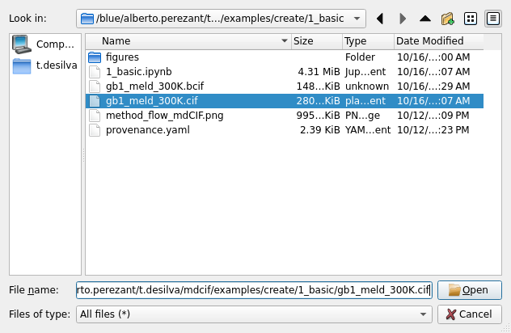

The Log shows ChimeraX's usual report on the file, then the plugin's summary of what the mdCIF
file holds:

```
gb1_meld_300K.cif: 2 models
  global set 1: 3 PCA modes on 56 atoms (name CA), 17683 frames, eigenvalues 203/35.5/25.6 A^2, sd 14/6/5.1 A, variance 60/11/8%
  5000 frames projected on global modes 1-3, 0% in no deposited cluster
  model 1: Cluster 1 medoid (frame 142700, t = 285.402 ns) (95% of frames)
    cluster set 2: 3 PCA modes on 56 atoms (name CA), 16847 frames, eigenvalues 37.4/28.5/10.8 A^2, sd 6.1/5.3/3.3 A, variance 26/20/8%
  model 2: Cluster 2 medoid (frame 127120, t = 254.242 ns) (5% of frames)
    cluster set 3: 3 PCA modes on 56 atoms (name CA), 836 frames, eigenvalues 7.59/5.57/3.35 A^2, sd 2.8/2.4/1.8 A, variance 20/14/9%
```

For each set of modes it gives the number of frames it was computed from, the size of each mode
(`sd`, one standard deviation of the motion, in Å) and each mode's share of the motion
(`variance`). There are two kinds of modes:

- **cluster** modes (the default in every command) are a model's own: how the protein moves
  while it stays in that state;
- **global** modes are computed over the whole simulation. The first three are the directions
  along which the frames were sorted into states.

ChimeraX also says that the file "contains IHM (integrative hybrid model) data" and suggests
opening it with `format ihm`. Ignore that: the normal open gives the `mdcif` commands everything
they need, and they don't work on a file opened as an Integrative Hybrid Model. Use the text
`.cif` file: the plugin doesn't read BinaryCIF (`.bcif`) or gzipped files.

Each model is its own structure. Colour them, model 1 blue and model 2 orange, on a white
background:

```
color #1.1 #2a78d6; color #1.2 #eb6834
set bgColor white; lighting soft; view
```

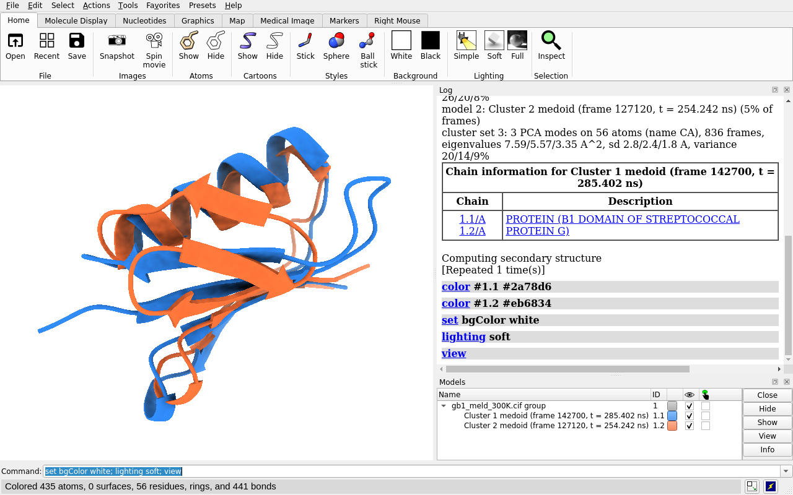

**Figure 1.** ChimeraX's window after opening the file. The **Models** panel (bottom right)
lists the two models under the file's name: **#1.1 is model 1**, the state seen most often, and
**#1.2 is model 2**. Each is named after its state's most typical frame (its medoid) and when it
occurred in the simulation. The **Log** (top right) keeps everything the commands report, and
the command line at the bottom is where you type.

Both models are aligned to the NMR structure 3GB1, so they overlap and you can compare their
shapes: the folded model 1 and the misfolded model 2.

`mdcif open` with the file's path does the same as `open`; it also reads a file whose name
doesn't end in `.cif`. `mdcif modes` prints the summary again, which is handy after the Log has
scrolled away.

The pictures below were saved with `save picture.png width 700 supersample 3`.

## 4. Porcupine plots

### 4.1. Draw the arrows

A porcupine plot turns a mode into a snapshot: an arrow on each Cα shows which way it moves and
how far it goes at 3σ (option `scale`). Tiny movements under 0.5 Å (option `minLength`) are left
out. Modes move in both directions, so the arrows could point the other way too.

```
hide #1.2 models
mdcif porcupine #1.1 mode 1
```

```
#1.1.1: 51 arrows, cluster mode 1 of model 1, 3 sd
```

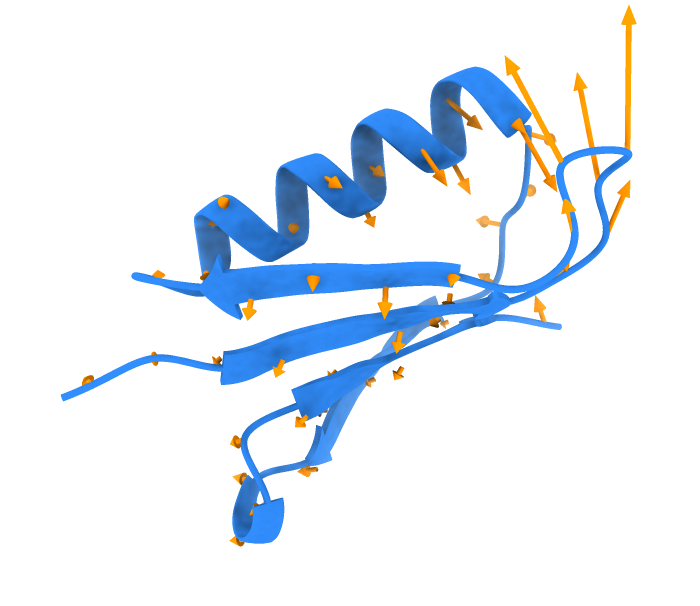

The arrows are a model of their own inside the structure (#1.1.1 here; the Log gives the
number), so they can be hidden or closed like any model: `close #1.1.1`. The longest arrows sit
on the β1–β2 turn (residues 9–13) and on the loop after the helix.

### 4.2. Options

All options are optional and go in any order:

| Option | Meaning | Default |
|---|---|---|
| `mode 2` | which mode (1 = largest) | 1 |
| `scale 2` | arrow length, in standard deviations (σ) | 3 |
| `color forestgreen` | arrow colour: any ChimeraX colour, also `#ff000080` with transparency | orange |
| `scope global` | the global modes instead of the model's own | cluster |
| `minLength 1` | leave out arrows shorter than this (Å; 0 keeps them all) | 0.5 |
| `radius 0.3` | arrow thickness (Å) | 0.15 |

Mode 2 of model 1, with shorter (2σ) green arrows:

```
close #1.1.1
mdcif porcupine #1.1 mode 2 scale 2 color forestgreen
```

```
#1.1.1: 34 arrows, cluster mode 2 of model 1, 2 sd
```

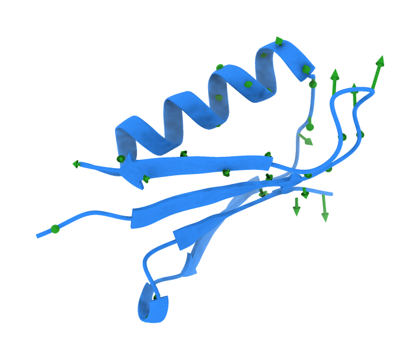

And global mode 1, the main direction of the whole simulation (the one along which the frames
were sorted into states), drawn in purple on the misfolded model 2:

```
close #1.1.1; hide #1.1 models; show #1.2 models
mdcif porcupine #1.2 mode 1 scope global color #6a3d9a
```

```
#1.2.1: 55 arrows, global mode 1 of model 2, 3 sd
```

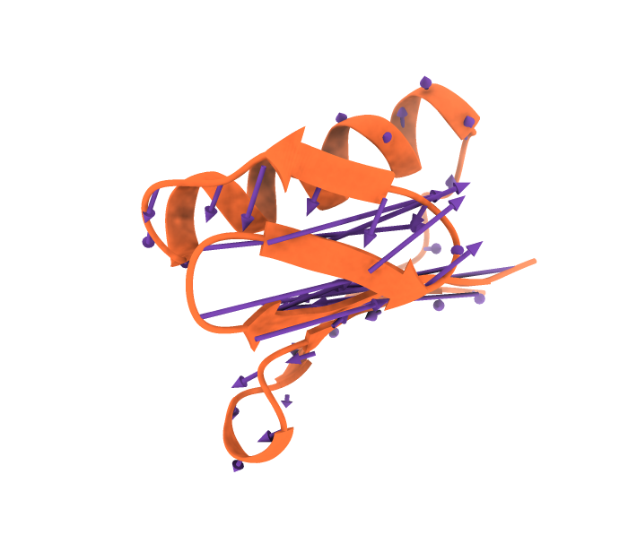

## 5. Bring the modes to life

Each mode gives every Cα a direction and a typical displacement, measured in Å. `mdcif animate`
turns that into a movie: it makes a copy of the model (a new model, #2 here) that swings back
and forth up to 3σ (option `amplitude`) and keeps playing. The original is hidden. Other atoms
follow their residue's Cα.

| Option | Meaning | Default |
|---|---|---|
| `mode 2` | which mode | 1 |
| `amplitude 2` | how far to swing, in standard deviations (σ) | 3 |
| `frames 10` | frames per back-and-forth cycle (at least 3) | 30 |
| `scope global` | the global modes | cluster |

These modes follow straight paths, so large motions can stretch bonds or loops. That's a
limitation of the approximation, not of the file: real protein motions follow more complex
paths.

Mode 1 of the folded model 1:

```
close #1.2.1; hide #1.2 models; show #1.1 models
mdcif animate #1.1 mode 1
```

```
#2: cluster mode 1 of model 1, 26% variance, +/-3 sd ('coordset stop #2' to stop)
```

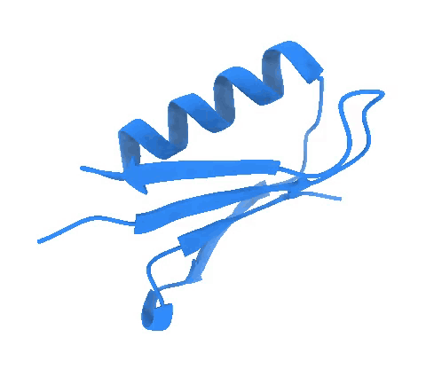

**Movie 1.** Model 1 swinging along its mode 1, ±3σ (two cycles; also as
[mp4](figures/model_1_mode_1.mp4)). The β1–β2 turn and the loop after the helix move the most,
as the porcupine plot showed.

The copy keeps playing until you stop it; the Log says how (`coordset stop #2`). To hold one
frame for a picture, stop first and then pick the frame: `coordset #2 8` is the +3σ turning
point with the default 30 frames. The copy keeps its model's modes, so `mdcif porcupine #2`
works on it too.

The misfolded model 2 along its own mode 1:

```
coordset stop #2; close #2; hide #1.1 models; show #1.2 models
mdcif animate #1.2 mode 1
```

```
#2: cluster mode 1 of model 2, 20% variance, +/-3 sd ('coordset stop #2' to stop)
```

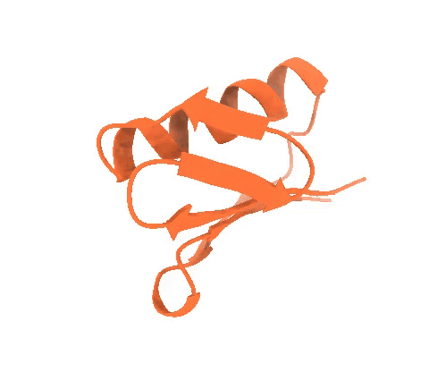

**Movie 2.** Model 2 along its mode 1, ±3σ ([mp4](figures/model_2_mode_1.mp4)). This state was
seen in only 5% of the frames, and its modes are smaller (σ = 2.8 Å for mode 1, against 6.1 Å
in model 1).

**Recording a movie yourself.** Start recording, start the motion, let it play for as many
frames as you want (60 = two cycles), then write the file:

```
movie record
mdcif animate #1.1 mode 1
wait 60
movie encode ~/model_1_mode_1.mp4
```

## 6. Morph between the models

`mdcif morph` uses ChimeraX's own `morph` command to make a new model (#2 here) that changes
smoothly from model 1 to model 2 and back to model 1: 20 frames per step, 41 in all. It plays
once.

```
coordset stop #2; close #2; show #1.1,2 models
mdcif morph #1
```

```
> morph #1.1 #1.2 frames 20 wrap true play true
Computed 41 frame morph #2
> coordset #2 1,41
```

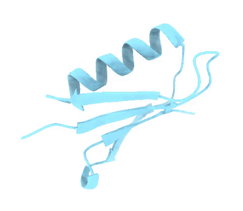

**Movie 3.** The morph from the folded model 1 to the misfolded model 2 and back
([mp4](figures/morph.mp4)). A morph is a straight interpolation between the two shapes: it shows
how they differ, not the path the simulation took.

To play it again, type `coordset #2`; to repeat it a few times, `coordset #2 1,41 loop 10`.
Option `frames 10` sets the frames per step, and `wrap false` stops at the last model. ChimeraX
also shows a slider to step through the frames (bottom right):

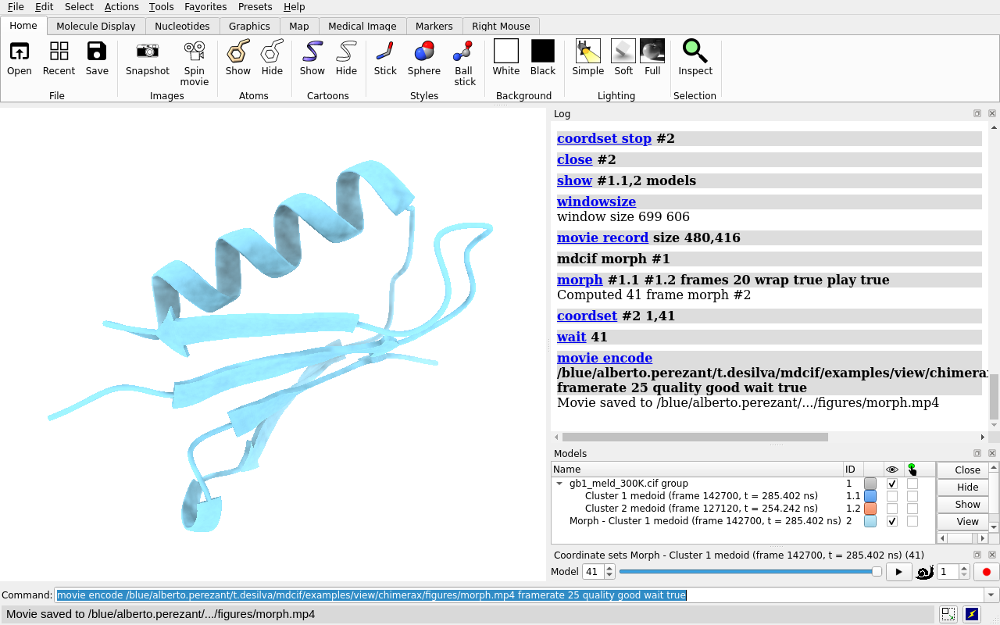

## 7. More with ChimeraX: pick residues, change the look

Everything ChimeraX can do works on these models. Two ideas cover most of it:

- An **atom specification** picks atoms: `#1.1` is model 1, `#1.1:9-13` its residues 9 to 13,
  `#1.1,2:12,39` residues 12 and 39 of both models, `:leu` every leucine, `@ca` the Cα atoms.
  Combine them with `&` (and), `|` (or) and `~` (not): `#1.1:9-13 & sidechain`. Residue
  numbers are the ones in the file.
- **Commands** say how to draw them: `cartoon` and `cartoon hide`, `show … atoms` and
  `hide … atoms`, `style … stick` (or `sphere`, `ball`), `color`, `label`, `surface`,
  `transparency`, `lighting`, and `view` to point the camera at them.

### 7.1. Highlight residues

The β1–β2 turn (residues 9–13) moves the most in all three modes of the folded state. Here it is
in model 1, with its side chains as sticks and every residue labelled (`pad` leaves some of the
protein around it in view):

```
close #2; show #1.1 models; hide #1.2 models
show #1.1:9-13 atoms; style #1.1:9-13 stick; color #1.1:9-13 byhetero
label #1.1:9-13 residues height 0.8; view #1.1:9-13 pad 0.4
```

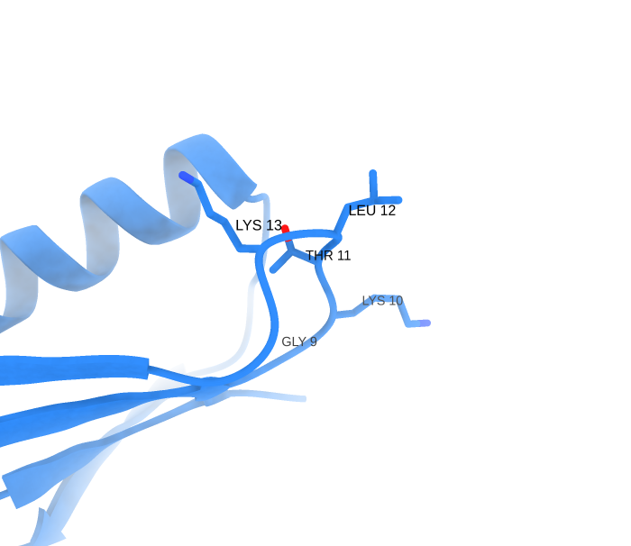

### 7.2. Show only some residues

To draw only part of the protein, hide all cartoons and show the residues you want. Here are
residues 1–20 (β1, the turn and β2): the hairpin of the folded model 1 (blue) next to the same
residues in the misfolded model 2 (orange).

```
label delete; hide #1.1:9-13 atoms; show #1.2 models
cartoon hide #1; cartoon #1.1,2:1-20; view #1.1,2:1-20
```

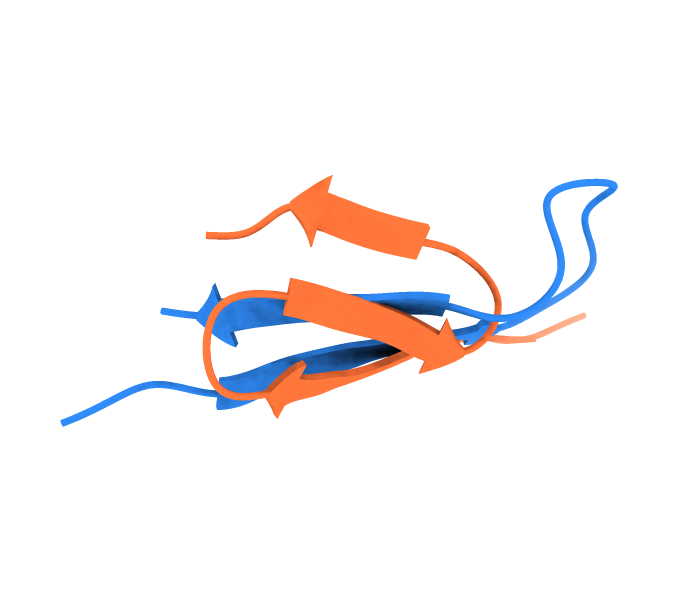

### 7.3. Residues in porcupine plots and movies

The arrows and the animated copies are ordinary models, so colours and selections work on them
the usual way. Here the turn is coloured pink in the porcupine plot of mode 1, which shows that
it carries the longest arrows. Hiding residues works less well in porcupine plots: the arrows
are not atoms, so they stay where they are (`close` them, or draw them again with `minLength`).

```
cartoon #1; hide #1.2 models; view
mdcif porcupine #1.1 mode 1
color #1.1:9-13 #b8336a target c
```

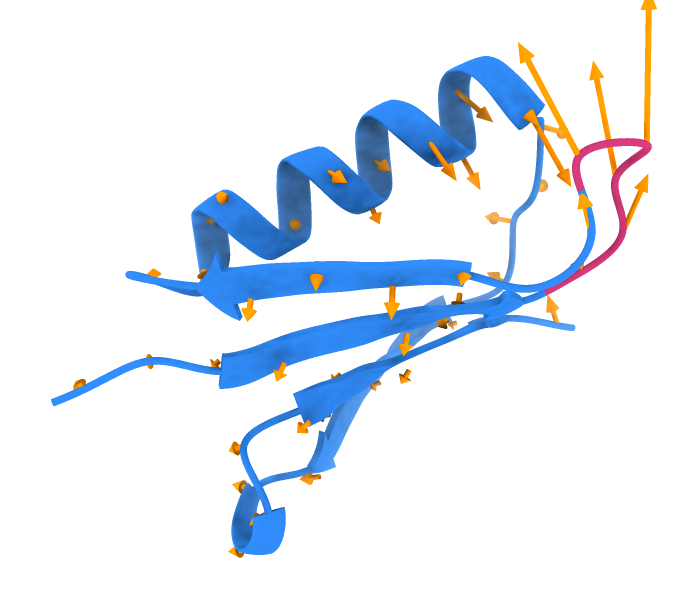

### 7.4. Visual effects

A few more of ChimeraX's options: a rainbow along the chain (`rainbow`, from the N-terminus in
blue to the C-terminus in red), a see-through molecular surface, outlines
(`graphics silhouettes`), shadows (`lighting full`) and a background colour:

```
close #1.1.1; rainbow #1.1
surface #1.1; transparency #1.1 70 target s
graphics silhouettes true; lighting full; set bgColor #f4f4f2; view
```

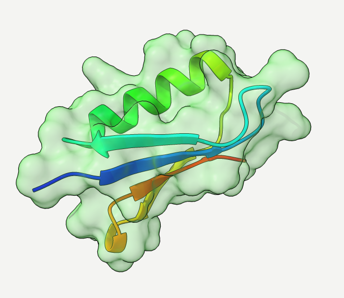

`turn y 1 360` spins the model once around the vertical axis.

## 8. Sessions

Save your work as a ChimeraX session, with `save` or File → Save…. When you open the session
again, the modes come back too, also for animated copies, as long as the mdCIF `.cif` file is
still where it was:

```
save ~/gb1.cxs
close session
open ~/gb1.cxs
mdcif porcupine #1.1 mode 3
```

```
mdcif: data of gb1_meld_300K.cif attached to #1.1 #1.2
opened ChimeraX session
#1.1.2: 39 arrows, cluster mode 3 of model 1, 3 sd
```

(The arrows are #1.1.2 this time because the surface from 7.4 is #1.1.1.) If the `.cif` file
has moved, the `mdcif` commands say "its file … is gone": open the `.cif` file again.

## 9. Command cheat sheet

| To… | type |
|---|---|
| open an mdCIF file | `open file.cif` (or File → Open…, or drag and drop); `mdcif open file.cif` |
| list the models and their modes | `mdcif modes` |
| draw the arrows of mode 2 of model 1 | `mdcif porcupine #1.1 mode 2` (options `scale`, `color`, `scope global`, `minLength`, `radius`) |
| remove those arrows | `close #1.1.1` (the Log gives the number) |
| play mode 1 of model 2 | `mdcif animate #1.2 mode 1` (options `amplitude`, `frames`, `scope global`) |
| stop it, or hold one frame | `coordset stop #2`, then `coordset #2 8` |
| morph through the models | `mdcif morph #1` (options `frames`, `wrap false`); again: `coordset #2` |
| every option of a command | `usage mdcif porcupine` |
| install or update the plugin | `toolshed uninstall ChimeraX-MDCIF` (if installed), `devel clean PATH`, `devel install PATH` |
| colour a model (or only its cartoon) | `color #1.1 cornflowerblue` (`… target c`) |
| show some residues as sticks | `show #1.1:9-13 atoms; style #1.1:9-13 stick` |
| save a picture | `save picture.png width 1200 supersample 3` |
| record a movie | `movie record`, then `mdcif animate …; wait 60`, then `movie encode movie.mp4` |
| save everything | `save mywork.cxs` |

**See more.** The ChimeraX User Guide explains every command, with all its options:

- [open](https://www.cgl.ucsf.edu/chimerax/docs/user/commands/open.html),
  [save](https://www.cgl.ucsf.edu/chimerax/docs/user/commands/save.html) and
  [close](https://www.cgl.ucsf.edu/chimerax/docs/user/commands/close.html)
- [atom specifications](https://www.cgl.ucsf.edu/chimerax/docs/user/commands/atomspec.html) and
  [select](https://www.cgl.ucsf.edu/chimerax/docs/user/commands/select.html)
- [color](https://www.cgl.ucsf.edu/chimerax/docs/user/commands/color.html) (also `rainbow`),
  [cartoon](https://www.cgl.ucsf.edu/chimerax/docs/user/commands/cartoon.html),
  [show and hide](https://www.cgl.ucsf.edu/chimerax/docs/user/commands/show.html),
  [style](https://www.cgl.ucsf.edu/chimerax/docs/user/commands/style.html),
  [label](https://www.cgl.ucsf.edu/chimerax/docs/user/commands/label.html)
- [surface](https://www.cgl.ucsf.edu/chimerax/docs/user/commands/surface.html),
  [transparency](https://www.cgl.ucsf.edu/chimerax/docs/user/commands/transparency.html),
  [lighting](https://www.cgl.ucsf.edu/chimerax/docs/user/commands/lighting.html),
  [graphics](https://www.cgl.ucsf.edu/chimerax/docs/user/commands/graphics.html),
  [view](https://www.cgl.ucsf.edu/chimerax/docs/user/commands/view.html),
  [turn](https://www.cgl.ucsf.edu/chimerax/docs/user/commands/turn.html)
- [coordset](https://www.cgl.ucsf.edu/chimerax/docs/user/commands/coordset.html),
  [morph](https://www.cgl.ucsf.edu/chimerax/docs/user/commands/morph.html),
  [movie](https://www.cgl.ucsf.edu/chimerax/docs/user/commands/movie.html) and
  [wait](https://www.cgl.ucsf.edu/chimerax/docs/user/commands/wait.html)
- [devel](https://www.cgl.ucsf.edu/chimerax/docs/user/commands/devel.html) and
  [toolshed](https://www.cgl.ucsf.edu/chimerax/docs/user/commands/toolshed.html), for
  installing the plugin
- the [Log](https://www.cgl.ucsf.edu/chimerax/docs/user/tools/log.html) and the
  [Models panel](https://www.cgl.ucsf.edu/chimerax/docs/user/tools/modelpanel.html)

