# Viewing an mdCIF file in PyMOL: a step-by-step tutorial

An mdCIF file captures a simulation's main states as model structures, plus the three largest
**modes** of each state. A mode shows how the atoms move together. This tutorial looks at such
a file in [PyMOL](https://pymol.org/) with the mdcif plugin for PyMOL (the folder
[`viewers/pymol-mdcif`](../../../viewers/pymol-mdcif)). The plugin adds a few `mdcif_`
commands, and a menu, **MDCIF**, whose windows do the main ones with sliders and buttons
instead of typing:

| Command | Or, in the MDCIF menu | What it does |
|---|---|---|
| `mdcif_porcupine` | Porcupine… | arrows showing how each Cα moves in one mode |
| `mdcif_animate` | Animate… | a copy of a model that swings back and forth along one mode |
| `mdcif_morph` | | a movie that morphs from one model to the next |
| `mdcif_plot` | Analyze… | a distance, angle or dihedral at every frame of a mode, in a window you can click |
| `mdcif_movie` | Save movie… (in Animate) | one cycle of an animation as a movie file |
| `mdcif_modes` | | lists the models and their modes |
| `mdcif_load` | | another way to open the file (the same as File → Open) |

We use the GB1 example, `examples/create/1_basic/gb1_meld_300K.cif`, made by
[`1_basic.ipynb`](../../create/1_basic/1_basic.ipynb): a 300 K MELD simulation of the protein G
B1 domain, summarised as two states. The [ChimeraX tutorial](../chimerax/tutorial.md) does the
same steps in ChimeraX.

**How to follow along.** Open PyMOL and type each block of commands at its command line (the
box marked `PyMOL>`), in order: each block continues from the one before. PyMOL commands take
their arguments after the command name, separated by commas, and options as `name=value`.
Where it helps, the text that PyMOL prints in its output area comes after the commands. Every
picture and movie here was made with open-source PyMOL 3.1 by
[`make_figures.py`](make_figures.py), which types these same commands; the plugin was also
tested in incentive PyMOL 3.1.9.

**Commands or windows.** Sections 4, 5 and 7 show each step twice: first as commands, then with
the window from the MDCIF menu that does the same (sections 4.3, 5.2 and 7.2). Use whichever
you like, or both. Whatever you do in a window, PyMOL's output shows the matching command, as
if you had typed it (`PyMOL>mdcif_porcupine …`), so the windows are also a good way to learn
the commands.

**You'll need:** PyMOL 2 or newer (we used 3.1), a copy of this repository (for the plugin),
the example file above, and an internet connection when you add the plugin (it installs
matplotlib, which draws the plots, if your PyMOL lacks it: section 2).

**Contents:** [1. Install PyMOL](#1-install-pymol) ·
[2. Add the plugin](#2-add-the-mdcif-plugin) · [3. Open the file](#3-open-the-file) ·
[4. Porcupine plots](#4-porcupine-plots) · [5. Movies of the modes](#5-bring-the-modes-to-life) ·
[6. Morph](#6-morph-between-the-models) ·
[7. Plot a distance, angle or dihedral](#7-plot-a-distance-angle-or-dihedral-along-a-mode) ·
[8. More with PyMOL](#8-more-with-pymol-pick-residues-change-the-look) ·
[9. Sessions](#9-sessions) · [10. Cheat sheet](#10-cheat-sheet-commands-and-windows)

## 1. Install PyMOL

Either PyMOL works:

- **Incentive PyMOL** (Schrödinger): go to <https://pymol.org/>, download the installer for
  your computer and run it. It needs a license (the website says how to get one; there are
  free ones for education); without one it runs for a trial period and writes "For Evaluation
  Only" on saved pictures.
- **Open-source PyMOL**: with conda, `conda install -c conda-forge pymol-open-source`. The
  repository's `mdcif` conda environment already has it (start it with `pymol`).

To see which PyMOL you have, type

```
print(cmd.get_version()[0])
```

```
3.1.0
```

## 2. Add the mdcif plugin

1. In PyMOL, choose **Plugin → Plugin Manager**, then the **Install New Plugin** tab.
2. Under "Install from local file", click **Choose file…** and pick
   `viewers/pymol-mdcif/__init__.py` in your copy of this repository.
3. PyMOL may ask which plugin directory to use: take the first one. If it then says it is
   "Unable to write to the plugin directory" and offers to create a user plugin directory,
   answer **Yes**.

PyMOL says `Plugin "pymol-mdcif" has been installed.` (the Plugin Manager names a plugin after
the folder it comes from), and its output shows

```
 mdcif_pymol 0.2.0 loaded: mdcif_load, mdcif_modes, mdcif_morph, mdcif_animate, mdcif_porcupine, mdcif_plot, mdcif_movie, mdcif_window (type 'mdcif' for more)
```

**matplotlib is installed for you.** The plots of section 7 are drawn with matplotlib, which
many PyMOLs don't have (incentive PyMOL doesn't, nor does open-source PyMOL from conda-forge).
When the plugin finds PyMOL without it, it installs it into PyMOL's own Python with pip, right
after you add the plugin. This needs an internet connection and takes a minute or so; it runs in
the background, so you can carry on meanwhile, and PyMOL's output follows along:

```
 mdcif: the Analyze window's plots need matplotlib, which this PyMOL lacks: installing it into PyMOL's Python with pip, in the background (PyMOL can be used meanwhile; it takes a minute or so) ...
   Collecting matplotlib
   ...
   Installing collected packages: tzdata, pyparsing, pillow, kiwisolver, fonttools, cycler, contourpy, python-dateutil, matplotlib
   Successfully installed contourpy-1.3.3 cycler-0.12.1 fonttools-4.68.0 kiwisolver-1.5.1 matplotlib-3.11.2 pillow-13.0.0 pyparsing-3.3.3 python-dateutil-4.0.0 tzdata-2026.6
 mdcif: matplotlib 3.11.2 installed: the Analyze window draws its plots (a window opened before now: close it and open it again)
```

The packages and versions depend on your PyMOL. PyMOL's own packages stay as they are (numpy
keeps its version). If matplotlib can't be installed, for example without internet, the output
says why and gives the command that installs it by hand for your PyMOL, to type in a terminal
(Command Prompt on Windows); the plugin also tries again the next time PyMOL starts. A PyMOL
that came with Linux (installed with apt or dnf) gets the system's command instead, such as
`sudo apt install python3-matplotlib`. Only the plots need matplotlib: everything else in this
tutorial works without it.

The plugin stays installed: it loads every time PyMOL starts. To check it, type `mdcif`:

```
 mdcif_pymol 0.2.0. Commands: mdcif_load | mdcif_modes | mdcif_morph | mdcif_animate | mdcif_porcupine | mdcif_plot | mdcif_movie | mdcif_window. Attaching mdcif data to loaded .cif files: on. Windows: menu MDCIF > Porcupine, Animate, Analyze. Plots: matplotlib 3.11.2.
```

"Attaching mdcif data to loaded .cif files: on" matters: the plugin looks at every `.cif` file
PyMOL opens, so you open an mdCIF file the normal way and the `mdcif_` commands just work. Other
mmCIF files open exactly as before.

The plugin also adds the menu **MDCIF** to PyMOL's menu bar, just before Help. Its three entries
open the windows of sections 4.3, 5.2 and 7. Hold the pointer over an entry to see what it does:

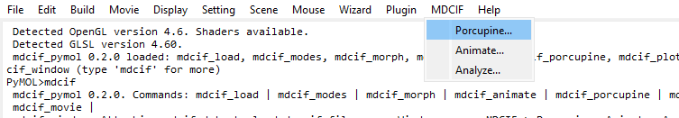

The same windows are also under **Plugin → MDCIF**, and the command `mdcif_window porcupine`
(or `animate`, `analyze`) opens them too. A window opened before any mdCIF file says so ("Load
an mdcif file (File > Open) …"), with its buttons greyed out, and fills in as soon as you open
one. The windows float on top of PyMOL: drag one aside by its title bar if it covers the
protein, or double-click the title bar to dock it at the side of PyMOL's window.

**To update** the plugin after its code has changed, install it again the same way (PyMOL asks
whether to install it again, or anyway: answer OK), then restart PyMOL. The plugin's files are
copied into PyMOL's plugin directory, so later changes to your copy of the repository need this
step. **Plugin → Plugin Manager → Installed Plugins** can disable or uninstall it (it is listed
as `pymol-mdcif`).

## 3. Open the file

Open the mdCIF file the way you open any structure in PyMOL: **File → Open…** and pick the
file, drag the file onto PyMOL's window, or type

```
load examples/create/1_basic/gb1_meld_300K.cif, gb1
```

This path starts at your copy of this repository: type `cd` and the folder of your copy first
(`pwd` shows the folder PyMOL is in), or give the file's full path instead.

The name after the comma, `gb1`, is optional: without it the objects are named after the file
(`gb1_meld_300K`). We use `gb1` to keep the commands short. PyMOL's output shows the plugin's
summary of what the mdCIF file holds:

```
examples/create/1_basic/gb1_meld_300K.cif: 2 models
  global set 1: 3 PCA modes on 56 atoms (name CA), 17683 frames, eigenvalues 203/35.5/25.6 A^2, sd 14/6/5.1 A, variance 60/11/8%
  5000 frames projected on global modes 1-3, 0% in no deposited cluster
  model 1: Cluster 1 medoid (frame 142700, t = 285.402 ns) (95% of frames)
    cluster set 2: 3 PCA modes on 56 atoms (name CA), 16847 frames, eigenvalues 37.4/28.5/10.8 A^2, sd 6.1/5.3/3.3 A, variance 26/20/8%
  model 2: Cluster 2 medoid (frame 127120, t = 254.242 ns) (5% of frames)
    cluster set 3: 3 PCA modes on 56 atoms (name CA), 836 frames, eigenvalues 7.59/5.57/3.35 A^2, sd 2.8/2.4/1.8 A, variance 20/14/9%
 mdcif: gb1_m1 = model 1, gb1_m2 = model 2 (group gb1)
```

For each set of modes it gives the number of frames it was computed from, the size of each mode
(`sd`, one standard deviation of the motion, in Å) and each mode's share of the motion
(`variance`). There are two kinds of modes:

- **cluster** modes (the default in every command) are a model's own: how the protein moves
  while it stays in that state;
- **global** modes are computed over the whole simulation. The first three are the directions
  along which the frames were sorted into states.

Each model is its own object, and the objects are in a group named after the file: **gb1_m1
is model 1**, the state seen most often, and **gb1_m2 is model 2**. (PyMOL on its own would
load the two models as two states of one object; the plugin splits them, so that you can
colour, show and hide each one.) Colour them, model 1 blue and model 2 orange, on a white
background:

```
color 0x2a78d6, gb1_m1
color 0xeb6834, gb1_m2
bg_color white
orient gb1
```

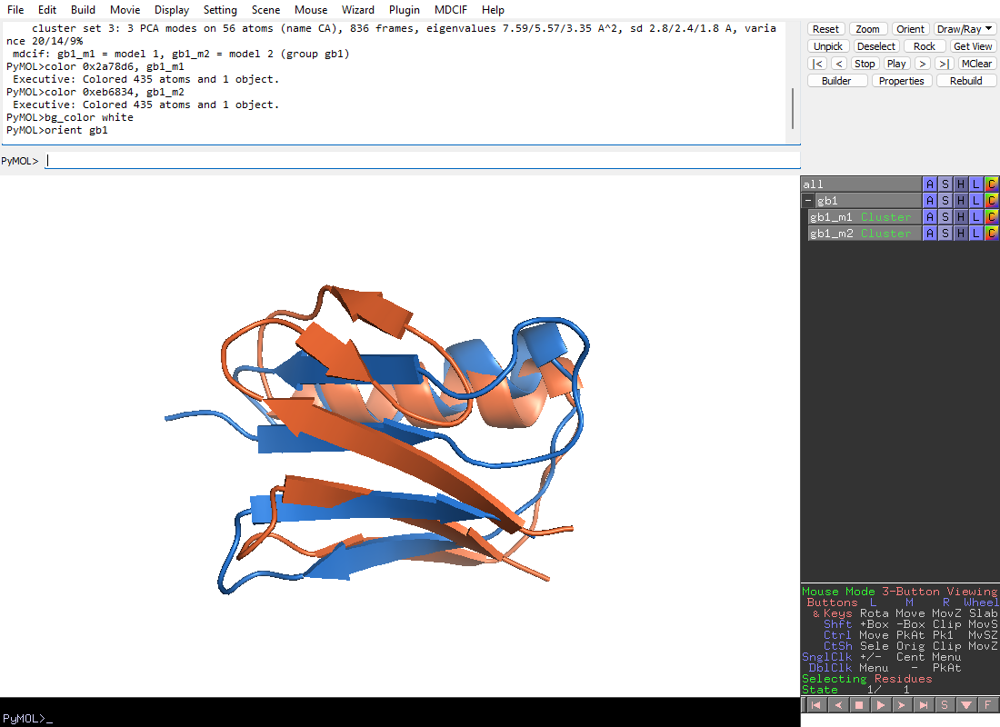

**Figure 1.** PyMOL's window after opening the file. The object list (right) has the group
**gb1**, opened here with its **+** to show **gb1_m1** and **gb1_m2**, each with the start of
its state's name ("Cluster 1 medoid ..."). Click a name to hide or show that object (or type
`disable gb1_m2`, `enable gb1_m2`). The output area (top) keeps everything the
commands print, and the command line under it is where you type.

Both models are aligned to the NMR structure 3GB1, so they overlap and you can compare their
shapes: the folded model 1 and the misfolded model 2.

`mdcif_load` with the file's path (and a name) does the same as `load`; it also reads a file
whose name doesn't end in `.cif`. `mdcif_modes gb1` prints the summary again, which is handy
after the output has scrolled away. The plugin reads text `.cif` files only: a BinaryCIF
(`.bcif`) or gzipped file opens as a plain structure, without modes.

The pictures below were saved with `png picture.png, width=700, height=606, ray=1`.

## 4. Porcupine plots

### 4.1. Draw the arrows

A porcupine plot turns a mode into a snapshot: an arrow on each Cα shows which way it moves and
how far it goes at 3σ (option `scale`). Tiny movements under 0.5 Å (option `min_length`) are
left out. Modes move in both directions, so the arrows could point the other way too.

```
disable gb1_m2
mdcif_porcupine gb1_m1, mode=1
```

```
 gb1_m1_mode1_porcupine: 51 arrows, cluster mode 1 of model 1, 3 sd
```


The arrows are an object of their own, `gb1_m1_mode1_porcupine` (a CGO object), so they can be
hidden or deleted like any object: `delete gb1_m1_mode1_porcupine`. The same command again
replaces them. The longest arrows sit on the β1–β2 turn (residues 9–13) and on the loop after
the helix.

### 4.2. Options

All options are optional and go in any order:

| Option | Meaning | Default |
|---|---|---|
| `mode=2` | which mode (1 = largest) | 1 |
| `scale=2` | arrow length, in standard deviations (σ) | 3 |
| `color=forest` | arrow colour: a PyMOL colour name, or `0x228b22` | orange |
| `scope=global` | the global modes instead of the model's own | cluster |
| `min_length=1` | leave out arrows shorter than this (Å; 0 keeps them all) | 0.5 |
| `radius=0.3` | arrow thickness (Å) | 0.15 |
| `name=my_arrows` | the name of the arrows' object | `<object>_mode<N>_porcupine` |

Mode 2 of model 1, with shorter (2σ) green arrows:

```
delete gb1_m1_mode1_porcupine
mdcif_porcupine gb1_m1, mode=2, scale=2, color=forest
```

```
 gb1_m1_mode2_porcupine: 34 arrows, cluster mode 2 of model 1, 2 sd
```

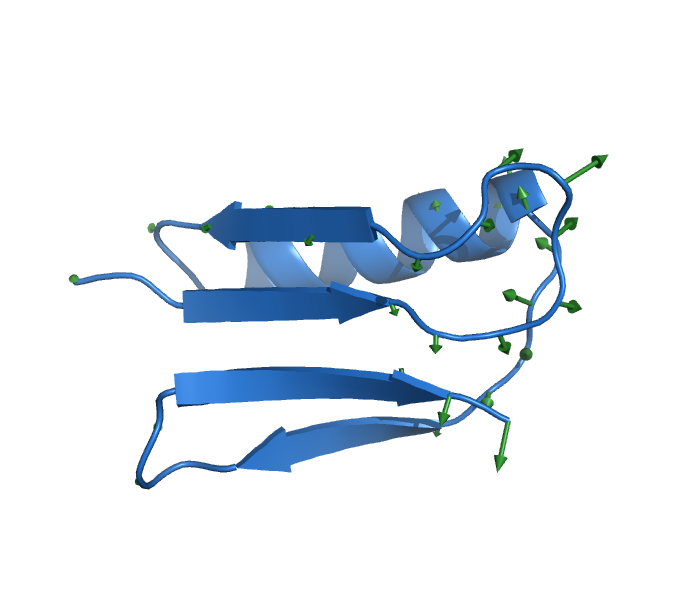

And global mode 1, the main direction of the whole simulation (the one along which the frames
were sorted into states), drawn in purple on the misfolded model 2:

```
delete gb1_m1_mode2_porcupine
disable gb1_m1
enable gb1_m2
mdcif_porcupine gb1_m2, mode=1, scope=global, color=0x6a3d9a
```

```
 gb1_m2_global1_porcupine: 55 arrows, global mode 1 of model 2, 3 sd
```

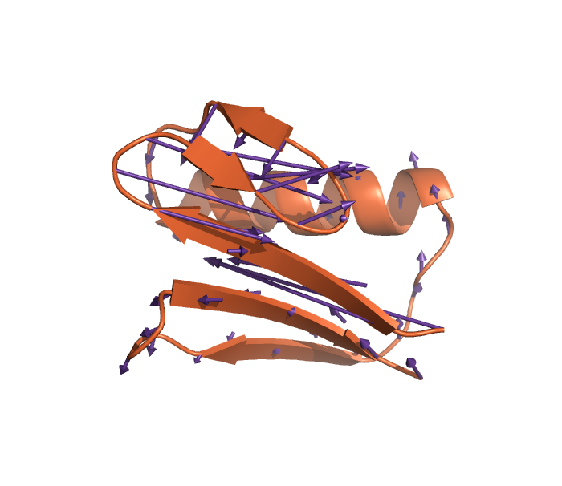

The arrows don't follow their model: `disable gb1_m2` hides the protein but not
`gb1_m2_global1_porcupine` (disable that too, or delete it).

### 4.3. With the window: MDCIF → Porcupine…

The **MDCIF Porcupine** window draws the same arrows with sliders, and can show several modes
at once. Put model 1 back on screen, in light grey this time so that the blue arrows of mode 2
stand out:

```
delete gb1_m2_global1_porcupine
disable gb1_m2
enable gb1_m1
color 0xc8c8c8, gb1_m1
```

Then choose **MDCIF → Porcupine…** in the menu bar. The window opens on model 1 (gb1_m1) with
mode 1 ticked, and draws its arrows at once: the same arrows as `mdcif_porcupine gb1_m1,
mode=1`, as the object `gb1_m1_mode1_porcupine`. PyMOL's output shows what happened, as
commands:

```
 PyMOL>mdcif_window porcupine
 PyMOL>mdcif_porcupine gb1_m1, mode=1, scale=3, color=0xff8000, scope=cluster, min_length=0.5, radius=0.15
```

Now tick modes **2** and **3** too. Each mode gets its own arrows, in the colour of the button
at the end of its row:

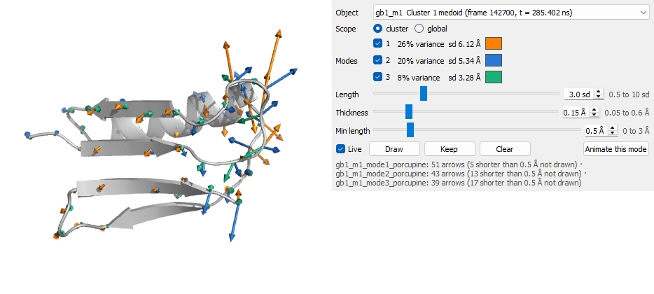

**Figure 2.** Modes 1, 2 and 3 of model 1 at once: orange, blue and green arrows, each set its
own object (`gb1_m1_mode1_porcupine`, `gb1_m1_mode2_porcupine` and `gb1_m1_mode3_porcupine`).
Each row gives the mode's share of the motion and its size (one standard deviation, sd). The
lines at the bottom say how many arrows each mode has.

Each control of the window is an option of `mdcif_porcupine` (section 4.2):

| In the window | Option of `mdcif_porcupine` |
|---|---|
| **Object** | the model to draw on (gb1_m1, gb1_m2, or a playing copy from section 5) |
| **Scope**: cluster or global | `scope` ("global" is greyed out for a file without global modes) |
| **Modes**: the tick boxes | `mode`: each ticked mode gets its own arrows |
| the colour button of a mode | `color`: click it for a colour chooser |
| **Length** (0.5 to 10 sd) | `scale` |
| **Thickness** (0.05 to 0.6 Å) | `radius` |
| **Min length** (0 to 3 Å) | `min_length` |

To draw what section 4.2 drew with a command, mode 2 alone with green arrows at 2σ:

1. Untick modes **1** and **3**.
2. Type `2` in the box beside **Length** and press Enter (or drag the slider to 2.0).
3. Click the colour button of mode 2. In the colour chooser, pick a green, or type `#228b22`
   in its **HTML** box, and click OK.

The arrows change as you go, and they stay the same object (`gb1_m1_mode2_porcupine`), so
nothing piles up. The line at the bottom then reads `gb1_m1_mode2_porcupine: 34 arrows (22
shorter than 0.5 Å not drawn)`: the 34 arrows of section 4.2. Once you stop changing things
(let go of the slider, press Enter), the output gets one command per ticked mode, not one for
every step of the slider. Here the last one is

```
 PyMOL>mdcif_porcupine gb1_m1, mode=2, scale=2, color=0x228b22, scope=cluster, min_length=0.5, radius=0.15
```

What else the window does:

- **Live** is on at the start: the arrows follow the sliders while you drag. With Live off,
  nothing changes until you click **Draw**.
- **Keep** leaves the arrows you see in the scene; the next change draws new ones next to them
  (`gb1_m1_mode2_porcupine_2`, …), for example to compare two thicknesses. **Clear** deletes
  the window's arrows that were not kept.
- A mode with no arrow left at your settings (try Min length 3 with Length 0.5) is named in red
  at the bottom: `mode 2: no arrows to draw for cluster mode 2 at 0.5 sd with min_length 3 A`.
- **Animate this mode** opens the Animate window of section 5.2 on the same model and mode.
- When the chosen model is hidden because its animation (section 5) is playing, a line offers
  to draw on the animation instead.
- Closing the window (the × in its corner) leaves its arrows in the scene.

Before the next section, click **Clear**, close the window, and colour model 1 blue again:

```
color 0x2a78d6, gb1_m1
```

## 5. Bring the modes to life

Each mode gives every Cα a direction and a typical displacement, measured in Å.
`mdcif_animate` turns that into a movie: it makes a copy of the model (a new object, here
`gb1_m1_mode1`) with one state per frame, swinging back and forth up to 3σ (option
`amplitude`), and plays it. The original is hidden. Other atoms follow their residue's Cα.

| Option | Meaning | Default |
|---|---|---|
| `mode=2` | which mode | 1 |
| `amplitude=2` | how far to swing, in standard deviations (σ) | 3 |
| `frames=10` | frames per back-and-forth cycle (at least 3) | 30 |
| `scope=global` | the global modes | cluster |

These modes follow straight paths, so large motions can stretch bonds or loops. That's a
limitation of the approximation, not of the file: real protein motions follow more complex
paths.

The animations play on PyMOL's own movie player, the buttons at the bottom right of the 3D view:
`mstop` stops it, `mplay` plays, `frame 8` shows frame 8, and `set movie_fps, 15` sets the
speed (frames per second). Every object with several states follows this one player, so two
animations play together; delete an animation you no longer need.

### 5.1. With commands

Mode 1 of the folded model 1:

```
mdcif_animate gb1_m1, mode=1
```

```
 gb1_m1_mode1: cluster mode 1 of model 1, 26% variance, +/-3 sd ('mstop' to stop)
```


**Movie 1.** Model 1 swinging along its mode 1, ±3σ. The β1–β2 turn and the loop after the
helix move the most, as the porcupine plot showed.

The copy keeps playing until you stop it. To hold one frame for a picture, stop first and then
pick the frame: `mstop` and `frame 8`, the +3σ turning point with the default 30 frames. The
copy keeps its model's modes, so `mdcif_porcupine gb1_m1_mode1` works on it too (drawn on its
first frame, the model's own coordinates).

The misfolded model 2 along its own mode 1:

```
delete gb1_m1_mode1
disable gb1_m1
enable gb1_m2
mdcif_animate gb1_m2, mode=1
```

```
 gb1_m2_mode1: cluster mode 1 of model 2, 20% variance, +/-3 sd ('mstop' to stop)
```

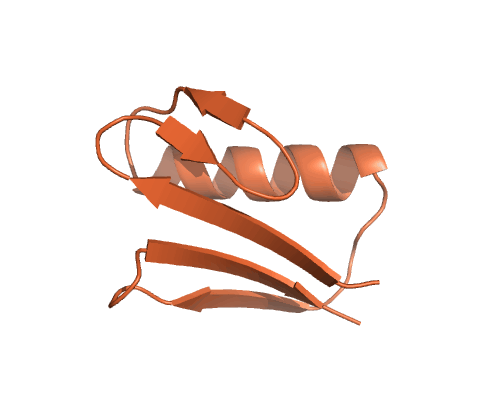

**Movie 2.** Model 2 along its mode 1, ±3σ. This state was seen in only 5% of the frames, and
its modes are smaller (σ = 2.8 Å for mode 1, against 6.1 Å in model 1).

### 5.2. With the window: MDCIF → Animate…

The **MDCIF Animate** window plays a mode with sliders, and changes it while it plays. Delete
the copy of model 2 and put model 1 back:

```
delete gb1_m2_mode1
disable gb1_m2
enable gb1_m1
```

Choose **MDCIF → Animate…**. The window opens on model 1 (gb1_m1), mode 1, and nothing moves
yet: the line at the bottom says `Play (or a change) animates a copy of gb1_m1, as
'mdcif_animate' does.` Click **Play**. The window makes a playing copy (`gb1_m1_mode1`),
exactly as `mdcif_animate` does, and the output shows that command:

```
 PyMOL>mdcif_animate gb1_m1, mode=1, amplitude=3, frames=30, scope=cluster
 gb1_m1_mode1: cluster mode 1 of model 1, 26% variance, +/-3 sd ('mstop' to stop)
```

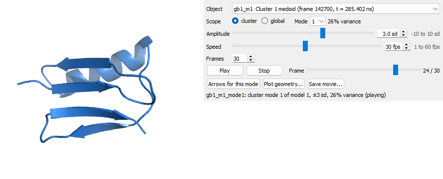

**Figure 3.** The MDCIF Animate window while the copy plays. The line at the bottom says what
plays, and the **Frame** slider follows the motion.

The controls are the options of `mdcif_animate` (section 5.1), plus a speed:

| In the window | Option of `mdcif_animate` |
|---|---|
| **Object** | the model to play |
| **Scope**: cluster or global, and **Mode** | `scope`, `mode` (the mode's share of the motion is shown next to it) |
| **Amplitude** (−10 to 10 sd) | `amplitude` (a negative number swings the other way first) |
| **Frames** (type a number, press Enter) | `frames` |
| **Speed** (1 to 60 frames per second) | none: PyMOL's `set movie_fps, N` |

Try these, in order:

1. Type `15` in the box beside **Speed** and press Enter: the copy now plays at half speed, and
   the output shows the command for that, `set movie_fps, 15`.
2. Drag the **Frame** slider to 8. The motion stops on that frame, the +3σ turning point, and
   the line at the bottom ends `(stopped at frame 8)`.
3. Click **Play** to start again (`frame 1; mplay`). Play always starts at frame 1; **Stop**
   stops the motion (`mstop`).
4. Click **Save movie…** to record one back-and-forth cycle as a movie (section 5.3).
5. Click **Arrows for this mode**. The Porcupine window of section 4.3 opens on the copy with
   this mode ticked, and draws its arrows (`gb1_m1_mode1_mode1_porcupine`: arrows of mode 1 on
   the copy `gb1_m1_mode1`). Click **Clear** there and close that window.
6. Click **Plot geometry…**. The Analyze window of section 7 opens for this copy, ready for the
   atoms to measure. Close it for now.
7. Choose **2** in the **Mode** list. The copy changes in place: it now plays mode 2, and it is
   renamed `gb1_m1_mode2` to say so. Once you stop changing things, the output says what the
   copy now plays, and which command makes a copy like it:

   ```
    gb1_m1_mode2 now plays cluster mode 2 of model 1, 20% variance, +/-3 sd, 30 frames (changed in place; a new copy like it: mdcif_animate gb1_m1, mode=2, amplitude=3, frames=30, scope=cluster)
   ```

   Amplitude, Frames and Scope change the copy in place the same way. Choosing another Object
   makes a new copy and deletes the old one.

Close the Animate window with the × in its corner: the copy keeps playing.

### 5.3. Record a movie

In the Animate window, **Save movie…** asks for a file name. The suggested name says what
plays, for example `gb1_meld_300K_model1_cluster_mode2.gif` in PyMOL's current folder. It
records one cycle at the speed you set (the 30 frames at 15 frames per second give a 2 s
movie). The window is greyed out while it records; then the line at the bottom says `Movie
saved to …`, and the motion plays on. The output shows the command it ran:

```
 PyMOL>mdcif_movie …/gb1_meld_300K_model1_cluster_mode2.gif, gb1_m1_mode2
 mdcif: movie saved to …/gb1_meld_300K_model1_cluster_mode2.gif (30 frames at 15 frames per second)
```

(`…` stands for the folder you chose.)

A GIF works in every PyMOL. MP4, WebM and QuickTime (`.mov`) movies need ffmpeg, which PyMOL
doesn't always have: when it is missing, the window offers GIF only, and PyMOL's **File →
Export Movie** offers to install it. (A GIF with two identical frames in a row, like the two
frames at each turning point, keeps one of them, shown twice as long.)

With commands, `mdcif_movie` records one cycle of an animation: the file, then the animated
object. `width` and `height` set the size in pixels, and `ray=1` ray-traces every frame
(slower, smoother; incentive PyMOL draws a size other than the 3D view's only by ray tracing, so
`mdcif_movie` then ray-traces by itself and says so):

```
mdcif_movie model_1_mode_1.gif, gb1_m1_mode1, width=480, height=416, ray=1
```

The movies above were made this way. PyMOL's own **File → Export Movie** works too.

## 6. Morph between the models

`mdcif_morph` makes a new object (`gb1_morph`) that changes smoothly from model 1 to model 2
and back to model 1: 20 frames per step, 40 in all. It plays in a loop.

```
delete gb1_m1_mode*
enable gb1_m1
enable gb1_m2
mdcif_morph gb1
```

```
 gb1_morph: 40 frames, models 1, 2 and back, 20 frames per step ('mstop' to stop)
```

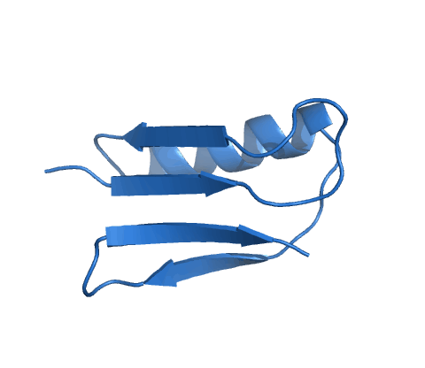

**Movie 3.** The morph from the folded model 1 to the misfolded model 2 and back. A morph is a
straight interpolation between the two shapes: it shows how they differ, not the path the
simulation took.

`mstop` stops it, `mplay` plays it again. Option `frames=10` sets the frames per step, and
`wrap=0` stops at the last model. `mdcif_morph gb1_m1 or gb1_m2` morphs through just the models
named.

## 7. Plot a distance, angle or dihedral along a mode

A movie shows a mode, and a plot puts numbers on it. `mdcif_plot` plays a mode, the same way
`mdcif_animate` does, and measures a distance, an angle or a dihedral at every frame. The result
opens in the **MDCIF Analyze** window, on its **Geometry** tab, with one point per frame.
Clicking a point stops the motion at that frame.

This section starts with the command, because it opens the window already filled in. Without
typing, the same window comes from **MDCIF → Analyze…**, or from **Plot geometry…** in the
Animate window (section 5.2); you then type or pick the atoms in it (sections 7.2 and 7.6).

### 7.1. A distance

Show model 1 on its own and measure the distance between the Cα atoms of Lys 10 (in the β1–β2
turn) and Asp 40 (in the loop after the helix). These are the two parts that move most in
mode 1.

```
delete gb1_morph
disable gb1_m2
enable gb1_m1
mdcif_plot distance, /gb1_m1//A/10/CA, /gb1_m1//A/40/CA
```

```
 PyMOL>mdcif_animate gb1_m1, mode=1, amplitude=3, frames=30, scope=cluster
 gb1_m1_mode1: cluster mode 1 of model 1, 26% variance, +/-3 sd ('mstop' to stop)
 gb1_m1_mode1 distance /A:10@CA - /A:40@CA along cluster mode 1 of model 1, +/-3 sd, 30 frames: min 6.64, max 13.99, mean 9.97 A
```

Each atom is a PyMOL selection of one atom, here written `/object//chain/residue/atom`
(`gb1_m1 and resi 10 and name CA` works too). The command made the same copy as
`mdcif_animate gb1_m1, mode=1` (`gb1_m1_mode1`, playing). It then measured the distance in
each of the copy's 30 frames. As the mode swings, the turn and the loop move between 6.6 and
14.0 Å apart.

A second distance along the same mode goes into the same window, in a new colour, and uses the
same copy. Type it as a command:

```
mdcif_plot distance, /gb1_m1//A/12/CA, /gb1_m1//A/38/CA
```

or type the two atoms into the window instead: `12CA` in the first **Atoms** box, `38CA` in the
second, then click **Add** (or press Return). Either way the output shows

```
 gb1_m1_mode1 distance /A:12@CA - /A:38@CA along cluster mode 1 of model 1, +/-3 sd, 30 frames: min 10.77, max 16.54, mean 12.93 A
```

### 7.2. The MDCIF Analyze window

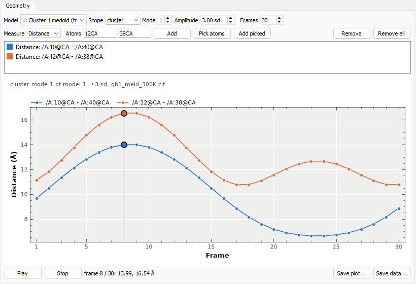

**Figure 4.** The MDCIF Analyze window with the two distances, stopped at frame 8 by a click on
the plot. Its title says what it plots, `MDCIF Analyze: distance on gb1_m1_mode1`. The plot is
on the **Geometry** tab, the only tab so far. Across the bottom are the frame numbers, and up
the side the distance. The second row holds the atoms typed for the second distance (`12CA`,
`38CA`).

- **Type atoms** in the second row. Choose what to measure under **Measure** (Distance, Angle
  or Dihedral). The window then shows 2, 3 or 4 **Atoms** boxes. Type a residue number and an
  atom name in each box, for example `38CA`. `38 CA`, `38@CA` and `/A:38@CA` work too, and lower
  case is fine. Then click **Add**, or press Return in any box. The atoms are looked up on the
  copy the window shows. The boxes keep what you typed, so for a neighbouring residue you only
  change a number. If an atom isn't there, a red message under the list says why and nothing
  is added, for example `atom 1, on gb1_m1_mode1: no atom /A:38@CB (residue 38 has N, CA, C,
  O)` (Gly 38 has no side chain). The message lists the atoms the residue does have.
- **Pick atoms** and **Add picked** take atoms you click in the 3D view (section 7.6).
- While the copy plays, the large dots and the thin vertical line move to the frame on screen.
  The line at the bottom gives the values there, for example `frame 8 / 30: 13.99, 16.54 Å`.
- **Click a point** to stop the motion at that frame. Frame 8 is the +3σ turning point, where
  both distances are largest. You can also hold the button down and drag along the plot to step
  through the frames. **Play** always starts the motion again from frame 1 (not from the frame
  shown), and **Stop** stops it.
- The top row changes the motion: **Model**, **Scope** (cluster or global), **Mode**,
  **Amplitude** (in σ) and **Frames**. After a change the window plays the new motion and
  measures every line again. The output shows the `mdcif_animate` command, and the copy the
  window made before is deleted. A typed number counts when you press Enter.
- **Remove** removes the lines you choose in the list, and **Remove all** removes all of them.
  A panel goes away with its last line.

### 7.3. See the distances on the structure

PyMOL's own `distance` command draws the two distances on the copy. A distance object has one
state per frame, so its dashes and label follow the motion while it plays.

```
distance d1, /gb1_m1_mode1//A/10/CA, /gb1_m1_mode1//A/40/CA
distance d2, /gb1_m1_mode1//A/12/CA, /gb1_m1_mode1//A/38/CA
color black, d1
color black, d2
set label_size, 24
```

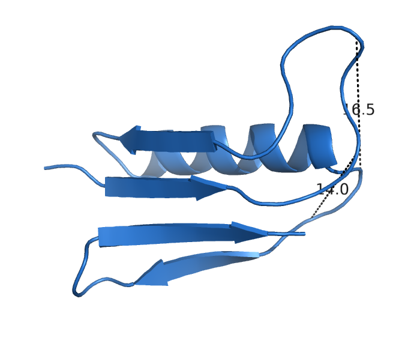

At frame 8 the labels read 14.0 and 16.5 Å, the same values the Analyze window gives. We checked
all 30 frames of the plot against PyMOL's `get_distance`, `get_angle` and `get_dihedral`, and
they agree.

### 7.4. Angles and dihedrals

An angle takes 3 atoms and a dihedral takes 4, in order. Atoms on the copy (`gb1_m1_mode1`) use
its frames, so no new copy is made. They go into the same window as the distances: the angle
gets a panel under the distances, and the dihedral a panel under that. All panels share the
frame axis, so you can read every value at the same frame.

```
mdcif_plot angle, /gb1_m1_mode1//A/10/CA, /gb1_m1_mode1//A/11/CA, /gb1_m1_mode1//A/12/CA
mdcif_plot dihedral, /gb1_m1_mode1//A/10/N, /gb1_m1_mode1//A/10/CA, /gb1_m1_mode1//A/10/C, /gb1_m1_mode1//A/11/N
```

```
 gb1_m1_mode1 angle /A:10@CA - /A:11@CA - /A:12@CA along cluster mode 1 of model 1, +/-3 sd, 30 frames: min 119.3, max 164.2, mean 138.7 deg
 gb1_m1_mode1 dihedral /A:10@N - /A:10@CA - /A:10@C - /A:11@N along cluster mode 1 of model 1, +/-3 sd, 30 frames: min 28.1, max 147.0, mean 94.3 deg
```

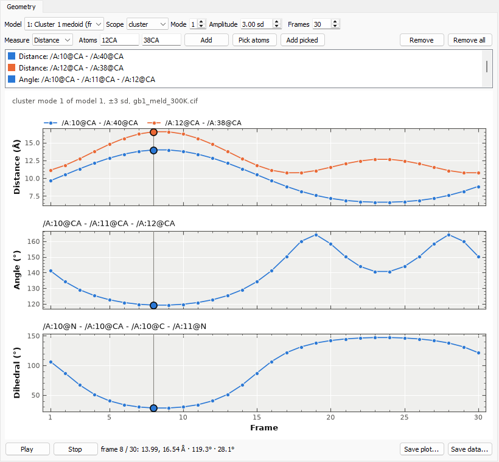

**Figure 5.** The same window after the two commands, stopped at frame 8: the distances at the
top, the angle in the middle, the dihedral at the bottom. The window is now called `MDCIF
Analyze: distance, angle, dihedral on gb1_m1_mode1`. The list names the kind of each line, and
the line at the bottom gives the values at the shown frame, kind by kind: `frame 8 / 30: 13.99,
16.54 Å · 119.3° · 28.1°`. A click or drag on any panel stops the motion at that frame. The
large dots and the vertical line then move in every panel.

In the window, you can do the same by choosing **Angle** under **Measure** and typing `10CA`,
`11CA` and `12CA` in the three boxes, or **Dihedral** and `10N`, `10CA`, `10C` and `11N` in four.
You can switch Measure at any time, and the lines already plotted stay. Up to 8 lines fit in
each panel. To put an angle or a dihedral in a separate plot instead, add `new=1` to the
command (it opens a second window, see section 7.5).

The angle is measured at the middle atom, Thr 11. The dihedral is ψ of Lys 10, with the same
sign as PyMOL's `get_dihedral` gives. A dihedral starts between −180° and 180° at frame 1, and
after that it changes smoothly, so it can go past ±180°. For example, ψ of Thr 11 reaches
256.4°, which is the same angle as −103.6°. A dihedral's CSV file (section 7.5) says so in an
extra line: `# dihedrals unwrapped from frame 1: values can pass +/-180 (subtract or add 360 for
PyMOL's get_dihedral, -180 to 180)`.

The same atoms in reverse order are the same measurement, so
`mdcif_plot distance, /gb1_m1_mode1//A/40/CA, /gb1_m1_mode1//A/10/CA` only prints `... is
already plotted`.

### 7.5. Save the plot and the numbers

In a window, **Save plot…** saves the picture (PNG, SVG or PDF) and **Save data…** saves the
numbers (a CSV file). Both save the whole plot, every panel and every line. The suggested names
say what is in the file, here `gb1_meld_300K_model1_cluster_mode1_distance-angle-dihedral.png`
and `.csv`. You can also save from the command line, which works without the window too:

```
mdcif_plot distance, /gb1_m1_mode1//A/10/CA, /gb1_m1_mode1//A/40/CA, save_image=gb1_mode1.png, save_data=gb1_mode1.csv
```

```
 gb1_m1_mode1 distance /A:10@CA - /A:40@CA is already plotted
 gb1_m1_mode1 distance + angle + dihedral plot: data saved to gb1_mode1.csv
 gb1_m1_mode1 distance + angle + dihedral plot: image saved to gb1_mode1.png
```

This distance is already plotted, so nothing is added: the command saves its whole plot, here
the two distances, the angle and the dihedral. The files go to PyMOL's current folder, which
`pwd` shows (`cd` changes it), or give a full path. The picture is 6 inches wide and 300 dpi,
without the current-frame marks. It is 3.5 inches high for one panel and 2.2 inches more for
each further panel, so 7.9 inches here (1800 × 2370 pixels):

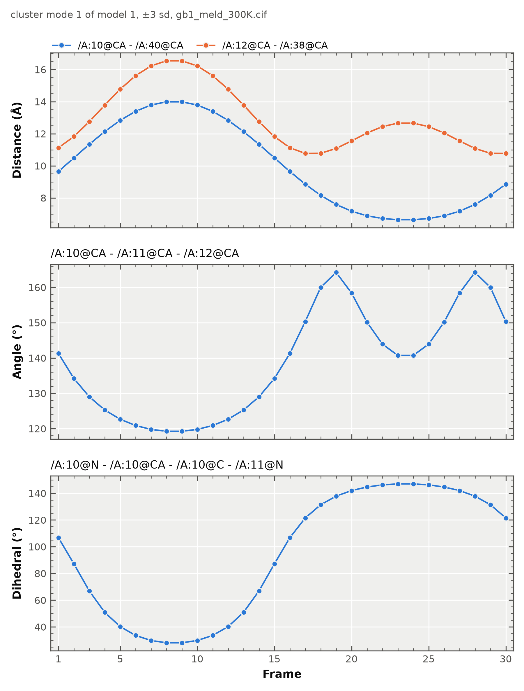

For a picture of one measurement on its own, start a separate plot with `new=1`. It opens a
second window, which you can close afterwards:

```
mdcif_plot dihedral, /gb1_m1_mode1//A/10/N, /gb1_m1_mode1//A/10/CA, /gb1_m1_mode1//A/10/C, /gb1_m1_mode1//A/11/N, new=1, save_image=gb1_psi10.png
```

```
 gb1_m1_mode1 dihedral /A:10@N - /A:10@CA - /A:10@C - /A:11@N along cluster mode 1 of model 1, +/-3 sd, 30 frames: min 28.1, max 147.0, mean 94.3 deg
 gb1_m1_mode1 dihedral plot: image saved to gb1_psi10.png
```

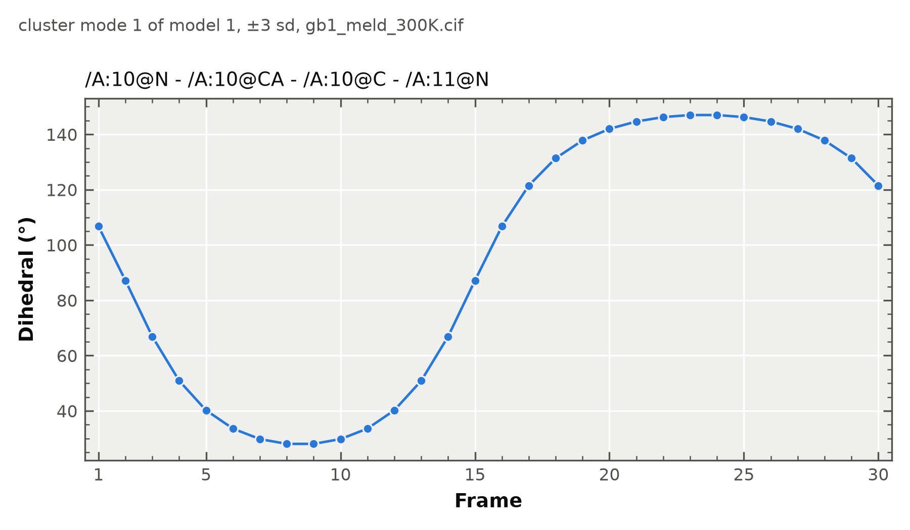

The CSV file starts with a few lines beginning with `#` that say what was measured. The `kind`
line lists the kinds in the plot with their units, and the extra dihedral line explains the
values past ±180° (section 7.4). Then comes one column per line of the plot, named by its atoms,
in the order the lines were added. Two atoms in a name mean a distance, three an angle and four
a dihedral. In Python, `pandas.read_csv("gb1_mode1.csv", comment="#")` reads it.

```
# mdcif plot (mdcif_pymol 0.2.0)
# file: …/examples/create/1_basic/gb1_meld_300K.cif
# model: 1 (Cluster 1 medoid (frame 142700, t = 285.402 ns))
# scope: cluster
# mode: 1
# amplitude: 3 sd
# frames: 30
# kind: distance (A), angle (deg), dihedral (deg)
# dihedrals unwrapped from frame 1: values can pass +/-180 (subtract or add 360 for PyMOL's get_dihedral, -180 to 180)
frame,/A:10@CA - /A:40@CA,/A:12@CA - /A:38@CA,/A:10@CA - /A:11@CA - /A:12@CA,/A:10@N - /A:10@CA - /A:10@C - /A:11@N
1,9.64629,11.1256,141.271,106.734
2,10.4915,11.8198,134.21,87.1693
...
```

### 7.6. Pick the atoms with the mouse

Atoms are easier to pick when they hold still, so if the copy is playing, click a point in the
plot to stop it. Then, in the Analyze window, with **Distance** chosen under **Measure**, click
**Pick atoms**. PyMOL's mouse now picks single atoms, and a line at the top left of the 3D view
says what to do:

```
MDCIF: click atom 1 of 2 for a distance
```

Click the Cα of Asp 40, then the Cα of Leu 12. A click on the cartoon picks the Cα of that
residue; to pick another atom, show it first (`show sticks, gb1_m1_mode1 and resi 12`). The
atoms picked so far are marked, and the line counts on. With the second atom the line
`/A:40@CA - /A:12@CA` is added to the distance panel, in picking order, and PyMOL's mouse goes
back to what it did before:

```
 gb1_m1_mode1 distance /A:40@CA - /A:12@CA along cluster mode 1 of model 1, +/-3 sd, 30 frames: min 10.52, max 22.24, mean 15.75 A
```

While you pick, the panel at the right of the 3D view has **Undo last atom** and **Cancel**.

PyMOL's own picked atoms work too: Ctrl-middle-click atoms in order (they become `pk1`, `pk2`,
…) and click **Add picked**, or type `mdcif_plot distance, pk1, pk2`. If too few atoms are
picked, a red message says so, and nothing is added:

```
a distance needs 2 picked atoms (pk1 to pk2), 0 are picked: click Pick atoms, or Ctrl-middle-click the atoms in order
```

**Start from an empty window.** When no Analyze window is open, **MDCIF → Analyze…** opens an
empty one. When Analyze windows are open, it brings them to the front instead, an empty one on
top, else the newest. **Plot geometry…** in the Animate window (section 5.2) also opens an empty
one, for the copy it plays. The empty window says what to do:

```
Type 2 atoms (e.g. 10CA 40CA) and click Add, or
click Pick atoms, then click 2 atoms in the viewer, in order
(a click on the cartoon picks the residue's CA;
'show sticks' to pick other atoms)
```

Choose Distance, Angle or Dihedral under **Measure**, then type or pick the atoms. Typed atoms
are looked up on the first mdcif object on screen. If no mdcif object is shown, the window says
so in red. Atoms on a model (gb1_m1) are measured on a copy of it that is already on screen, if
there is one, else played with the settings in the window's top row. Atoms on a copy use that
copy.

### 7.7. Tidy up

```
delete d1
delete d2
```

Close the Analyze windows with the × in their corner. Closing a window leaves its copy playing,
and a later `mdcif_plot` on model 1 uses that copy again instead of making a second one. If you
delete the copy first, the window stays: it says the animation was deleted, and Save plot and
Save data still work.

## 8. More with PyMOL: pick residues, change the look

Everything PyMOL can do works on these objects. Two ideas cover most of it:

- A **selection** picks atoms: `gb1_m1` is model 1, `gb1_m1 and resi 9-13` its residues 9 to
  13, `(gb1_m1 or gb1_m2) and resi 12+39` residues 12 and 39 of both models, `resn LEU` every
  leucine, `name CA` the Cα atoms. Combine them with `and`, `or` and `not`. Residue numbers
  are the ones in the file.
- **Commands** say how to draw them: `show cartoon` and `hide cartoon`, `show sticks`, `color`,
  `label`, `show surface`, `set transparency`, and `orient` or `zoom` to point the camera at
  them. A command's last argument is usually the selection: `show sticks, gb1_m1 and resi 9`.

### 8.1. Highlight residues

The β1–β2 turn (residues 9–13) moves the most in all three modes of the folded state. Here it is
in model 1, with its side chains as sticks and every residue labelled:

```
delete gb1_m1_mode1
enable gb1_m1
disable gb1_m2
show sticks, gb1_m1 and resi 9-13 and not name N+C+O
color atomic, gb1_m1 and resi 9-13 and not elem C
label gb1_m1 and resi 9-13 and name CA, "%s%s" % (resn, resi)
set label_size, 20
orient gb1_m1 and resi 9-13
zoom gb1_m1 and resi 9-13, 4
```

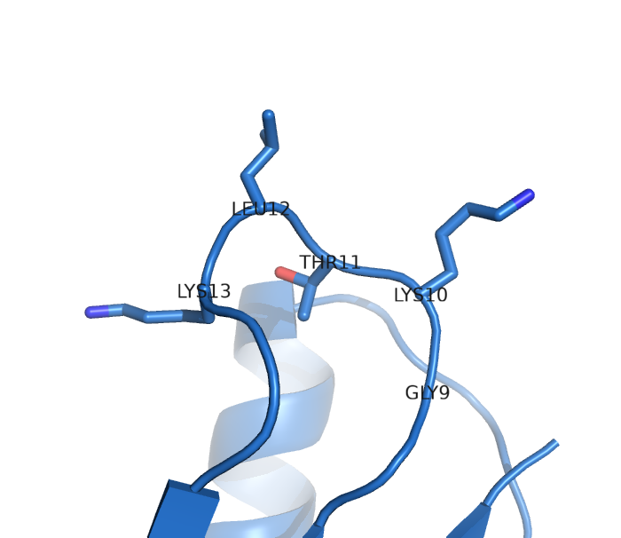

### 8.2. Show only some residues

To draw only part of the protein, hide all cartoons and show the residues you want. Here are
residues 1–20 (β1, the turn and β2): the hairpin of the folded model 1 (blue) next to the same
residues in the misfolded model 2 (orange).

```
label
hide sticks
enable gb1_m2
hide cartoon
show cartoon, (gb1_m1 or gb1_m2) and resi 1-20
orient (gb1_m1 or gb1_m2) and resi 1-20
```

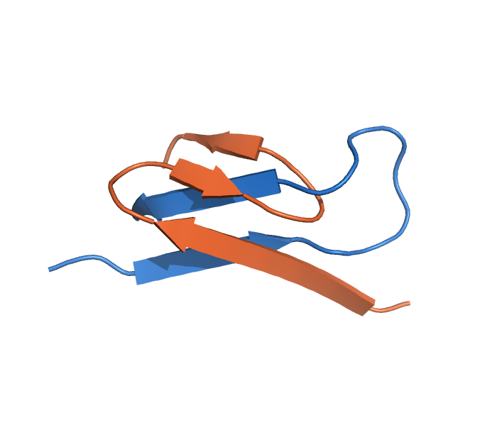

(`label` with nothing after it removes all labels.)

### 8.3. Residues in porcupine plots and movies

The arrows and the animated copies are ordinary objects, and the copies have the same atoms as
their model, so colours and selections work on them the usual way. Here the turn is coloured
pink under the porcupine plot of mode 1, which shows that it carries the longest arrows. Hiding
residues works less well in porcupine plots: the arrows are not atoms, so they stay where they
are (delete them, or draw them again with `min_length`).

```
show cartoon
disable gb1_m2
orient gb1
mdcif_porcupine gb1_m1, mode=1
color 0xb8336a, gb1_m1 and resi 9-13
```

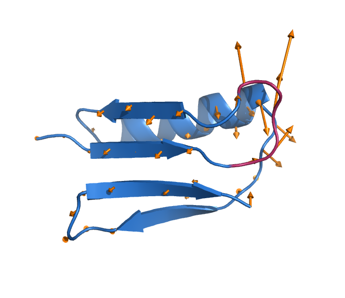

### 8.4. Visual effects

A few more of PyMOL's options: a rainbow along the chain (`spectrum`, from the N-terminus in
blue to the C-terminus in red), a see-through molecular surface, outlines (`ray_trace_mode`, in
ray-traced pictures) and a background colour:

```
delete gb1_m1_mode1_porcupine
spectrum resi, rainbow, gb1_m1
show surface, gb1_m1
set transparency, 0.7
set ray_trace_mode, 1
bg_color 0xf4f4f2
```

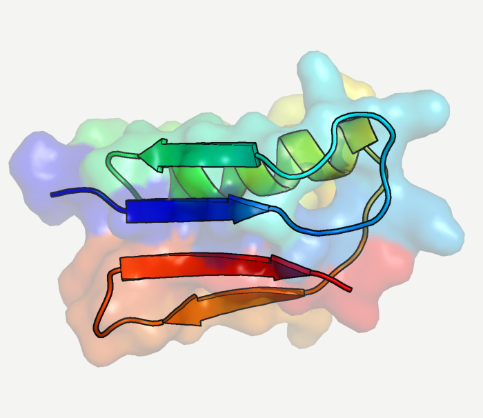

`ray` draws the picture with these effects in the 3D view (any change to the view goes back to
the normal drawing), and `png picture.png, width=1200, ray=1` saves it. `turn y, 180` turns the
model around the vertical axis, and **Movie → Rock** rocks it.

## 9. Sessions

Save your work as a PyMOL session, with `save` or File → Save Session. When you open the session
again, the modes come back too, also for animated copies, as long as the mdCIF `.cif` file is
still where it was:

```
set ray_trace_mode, 0
hide surface
mdcif_animate gb1_m1, mode=2
save gb1.pse
reinitialize
load gb1.pse
mdcif_porcupine gb1_m1, mode=3
```

```
 gb1_m1_mode2: cluster mode 2 of model 1, 20% variance, +/-3 sd ('mstop' to stop)
 Save: Please wait -- writing session file...
 Save: wrote "gb1.pse".
 mdcif: data attached to gb1_m1 gb1_m2 gb1_m1_mode2
 gb1_m1_mode3_porcupine: 39 arrows, cluster mode 3 of model 1, 3 sd
```

If the `.cif` file has moved, the session still opens, with a line saying the file is gone, and
the `mdcif_` commands then say "its file … is gone": load the `.cif` file again. Porcupine arrows
come back as they were, in their colours, whether you drew them with `mdcif_porcupine` or with
the Porcupine window.

**The MDCIF windows (Porcupine, Animate and Analyze, with its plots) are not saved in a
session.** Opening a session closes none of them, but they don't know about the session's
objects until you choose them again; it is simplest to close them first and open them again
from the MDCIF menu. An animated copy is saved, and it remembers its mode. After you open the
session again, type the plot command again, for example
`mdcif_plot distance, /gb1_m1_mode2//A/10/CA, /gb1_m1_mode2//A/40/CA` with the copy's atoms:
it uses the restored copy's frames and makes no new copy.

## 10. Cheat sheet: commands and windows

| To… | type | or, in the MDCIF menu |
|---|---|---|
| open an mdCIF file | `load file.cif, gb1` (or File → Open…, or drag and drop); `mdcif_load file.cif, gb1` | |
| list the models and their modes | `mdcif_modes gb1` | (each window lists the modes of its model) |
| draw the arrows of mode 2 of model 1 | `mdcif_porcupine gb1_m1, mode=2` (options `scale`, `color`, `scope=global`, `min_length`, `radius`, `name`) | Porcupine…: Object gb1_m1, tick 2; sliders Length, Thickness, Min length |
| draw several modes at once | one `mdcif_porcupine` per mode | Porcupine…: tick them all |
| remove those arrows | `delete gb1_m1_mode2_porcupine` | Porcupine…: Clear |
| play mode 1 of model 2 | `mdcif_animate gb1_m2, mode=1` (options `amplitude`, `frames`, `scope=global`) | Animate…: Object gb1_m2, Mode 1, Play |
| change what plays | a new `mdcif_animate` (a new copy) | Animate…: Mode, Amplitude, Frames (the same copy, changed in place) |
| stop it, or hold one frame | `mstop`, then `frame 8` | Animate…: Stop; drag the Frame slider |
| play it slower | `set movie_fps, 15` | Animate…: Speed |
| morph through the models | `mdcif_morph gb1` (options `frames`, `wrap=0`); again: `mplay` | |
| plot a distance along mode 1 of model 1 | `mdcif_plot distance, /gb1_m1//A/10/CA, /gb1_m1//A/40/CA` (options `mode`, `scope=global`, `amplitude`, `frames`, `new=1`) | Analyze… (or Plot geometry… in Animate): type `10CA` `40CA`, click Add |
| plot an angle or a dihedral | `mdcif_plot angle` with 3 atoms, `mdcif_plot dihedral` with 4, in order (a panel under the distances; `new=1` for a plot of its own); `pk1, pk2, …` = the atoms you picked | Analyze…: choose Measure, type 3 or 4 atoms, Add (or Pick atoms) |
| stop the motion at one frame of the plot | | click that point in any panel of the Analyze window |
| save a plot and its numbers | `mdcif_plot … save_image=plot.png, save_data=plot.csv` | Analyze…: Save plot… / Save data… (every panel) |
| open a window | `mdcif_window porcupine` (or `animate`, `analyze`) | the MDCIF menu, or Plugin → MDCIF |
| every option of a command | `help mdcif_porcupine` | |
| install or update the plugin | Plugin → Plugin Manager → Install New Plugin → `viewers/pymol-mdcif/__init__.py`, then restart PyMOL (matplotlib comes with it) | |
| colour a model | `color 0x6495ed, gb1_m1` | |
| show some residues as sticks | `show sticks, gb1_m1 and resi 9-13` | |
| save a picture | `png picture.png, width=1200, ray=1` | |
| record a movie | `mdcif_movie movie.gif, gb1_m1_mode1` (`.mp4` with ffmpeg) | Animate…: Save movie… (one cycle) |
| save everything | `save mywork.pse` (the MDCIF windows are not saved) | |

**See more.** The PyMOL Wiki explains every command, with all its options:

- [load](https://pymolwiki.org/index.php/Load), [save](https://pymolwiki.org/index.php/Save),
  [delete](https://pymolwiki.org/index.php/Delete) and
  [Plugin Manager](https://pymolwiki.org/index.php/Plugin_Manager)
- [selections](https://pymolwiki.org/index.php/Selection_Algebra) and
  [selection macros](https://pymolwiki.org/index.php/Selection_Macros) (`/gb1_m1//A/10/CA`),
  [enable](https://pymolwiki.org/index.php/Enable) and
  [disable](https://pymolwiki.org/index.php/Disable)
- [distance](https://pymolwiki.org/index.php/Distance),
  [get_distance](https://pymolwiki.org/index.php/Get_Distance),
  [get_angle](https://pymolwiki.org/index.php/Get_Angle) and
  [get_dihedral](https://pymolwiki.org/index.php/Get_Dihedral), PyMOL's own measurements;
  [pwd](https://pymolwiki.org/index.php/Pwd) and [cd](https://pymolwiki.org/index.php/Cd) for
  the folder files are saved in
- [color](https://pymolwiki.org/index.php/Color),
  [spectrum](https://pymolwiki.org/index.php/Spectrum),
  [show](https://pymolwiki.org/index.php/Show), [hide](https://pymolwiki.org/index.php/Hide),
  [cartoon](https://pymolwiki.org/index.php/Cartoon),
  [label](https://pymolwiki.org/index.php/Label)
- [surface](https://pymolwiki.org/index.php/Surface),
  [transparency](https://pymolwiki.org/index.php/Transparency),
  [ray_trace_mode](https://pymolwiki.org/index.php/Ray_trace_mode),
  [ray](https://pymolwiki.org/index.php/Ray), [png](https://pymolwiki.org/index.php/Png),
  [orient](https://pymolwiki.org/index.php/Orient), [zoom](https://pymolwiki.org/index.php/Zoom),
  [turn](https://pymolwiki.org/index.php/Turn)
- [mplay](https://pymolwiki.org/index.php/Mplay), [mstop](https://pymolwiki.org/index.php/Mstop),
  [frame](https://pymolwiki.org/index.php/Frame),
  [movie_fps](https://pymolwiki.org/index.php/Movie_fps) and
  [states](https://pymolwiki.org/index.php/States)
